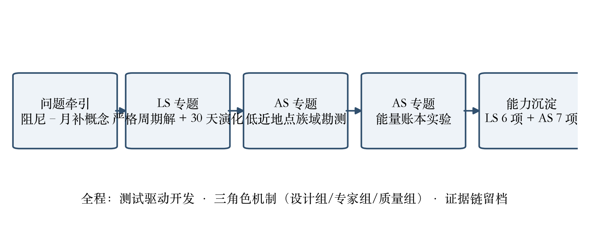
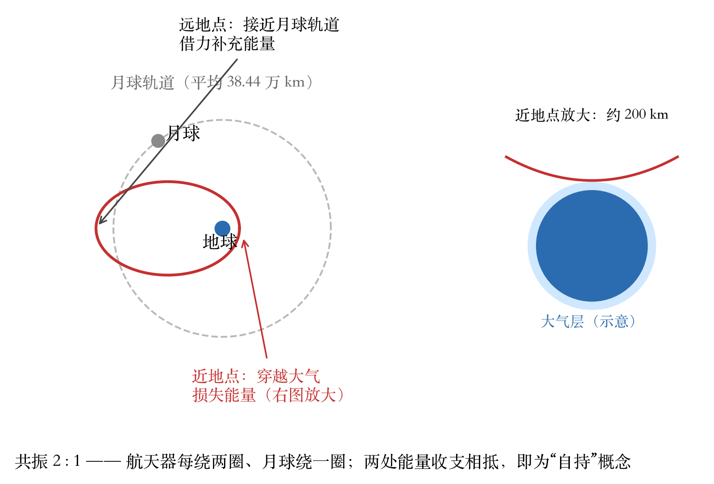
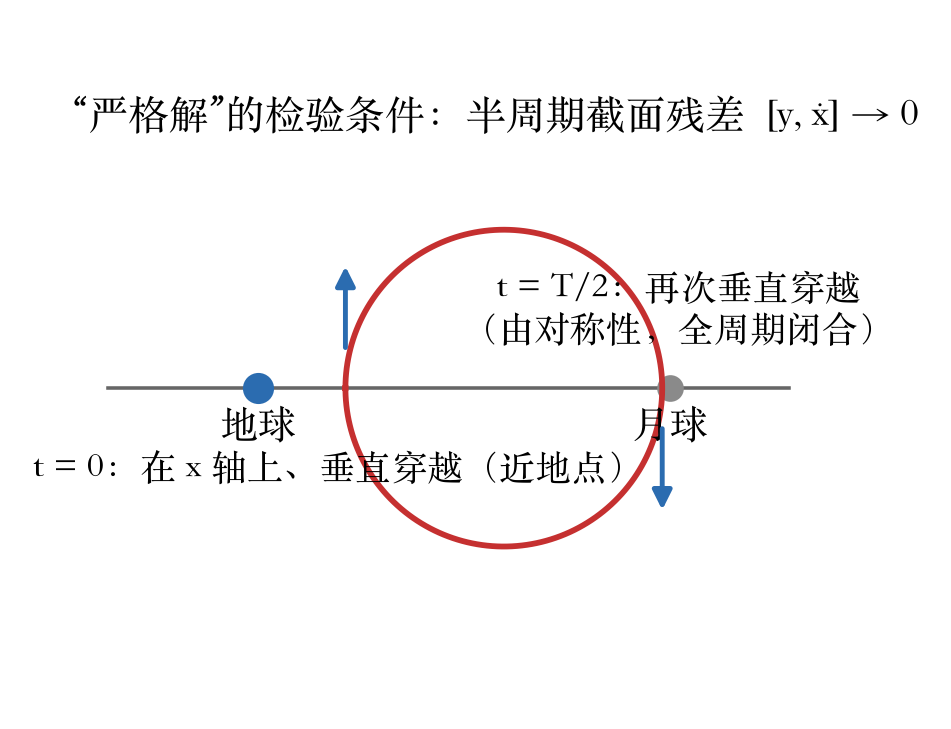
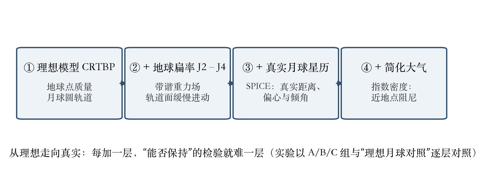

# 第一篇　研究总览

> 本报告汇总 LUNAR-SWING 研究线两轮专题的完整成果与证据：LS 专题（严格周期解与摄动演化）与 AS 专题（低近地点族域勘测与能量账本）。全部数值以留档证据为准，可复算路径见 §1.4。

## 1.1 研究缘起与问题链

LUNAR-SWING 的原始概念（2026-04 版项目文档 [12]）提出一条颇具想象力的轨道机制：低近地点（≤200 km）大气穿越耗散能量，而远地点附近的月球借力补充能量，两者在 2:1 共振相位下形成“无燃料轨道维持”的能量平衡。该概念在原理上成立与否，涉及两个层次的问题：其一，**严格周期解是否存在且可被数值求解**；其二，**真实摄动环境下该机制是否可实现**。原始项目的概念文档齐备，但结果目录为空、原型解的速度残差达 0.20（未闭合）——本报告记录的研究工作正是从这一现状出发，把大问题拆成两轮由证据牵引的专题：

- **LS 专题**：先把 2:1 共振族做到判据严格的周期解，并完成首次 30 天高保真摄动演化，回答“是否有界”；
- **AS 专题**：把求解与演化推进到概念所要求的低近地点几何，回答“族是否存在、能量账本是否闭合”。

两轮专题的关系与能力沉淀路径见图 1-1。

*图 1-1　两轮专题的研究链与能力沉淀*

## 1.2 直观导读：三张图看懂这项研究

> 本章写给非航天动力学专业的读者；严谨表述与判据以后续各篇为准。

“大气阻尼—月球借力”的机制可以用图 1-2 一眼看懂：航天器沿一条很扁的大椭圆运行，**近地点**贴着地球大气层上缘飞过、每圈损失一点能量（阻尼）；**远地点**则安排在与月球轨道相近的位置、借月球引力把能量补回来。若两者恰好相抵，轨道便可“自持”。概念要求航天器每绕地球两圈、月球恰好绕一圈（即 2:1 共振），使每次相遇的几何重复出现。近地点在真实比例下紧贴地球、图中无法看清，故在右侧放大示意。

*图 1-2　“大气阻尼—月球借力”机制示意（右为近地点放大）*

所谓“严格周期解”，含义见图 1-3：这项研究不满足于“差不多能绕圈”，而是要求数值解在**半周期处再次垂直穿过地月连线**——由系统对称性，这一条件等价于整个周期严丝合缝地闭合（位置与速度都回到原值）。全篇反复出现的“闭合残差 10⁻⁹”等判据，说的就是把这两处对齐做到多准。

*图 1-3　对称判据（半周期垂直穿越）与全周期闭合*

最后一张直觉图（图 1-4）解释研究如何从理想走向真实：先在只有地球点质量引力与月球圆轨道的**理想模型**里把解求准，再逐层加入地球扁率、真实月球星历与大气——每加一层，“能否保持”的检验就更难一层，这也是实验设计“理想月球对照”的原因。

*图 1-4　四层模型阶梯：从理想 CRTBP 到含大气的真实模型*

## 1.3 方法与组织

全部工作采用“设计组—专家组—质量组”三角色机制与测试驱动开发（TDD）：立项件、红基线、变更单（CR）、里程碑评审与监督记录全程留档 [1][2][5][6][7][10][11]。研究结论只以可复算的证据为依据；**负结果同样按留档规范交付**（AS 专题的族域勘测即为一例）。

计算底座为 MCPC 数字镜像框架自有的动力学与场景模块；AS 专题另沉淀了 Apple Silicon 异构加速批处理求解内核（CR-AS-01 [10]）。本总结报告自身即由项目内的 `primer.book` 成书工具链排版（markdown → LaTeX → PDF），并经确定性质检与逐页视觉抽检。

## 1.3 主要结论速览

两轮专题的结论速览见表 1-1，详细出处见各篇。

**表 1-1　两轮专题结论速览**

| 问题 | 结论 | 出处 |
|---|---|---|
| 2:1／3:2 严格周期解可否求出 | **可**：全状态闭合 1.02×10⁻⁹／9.48×10⁻⁹，Jacobi 漂移≈0 | 第二篇 §2.2；[3][4] |
| 严格解在真实摄动下是否有界 | **有界**（30 天）：理想模型精确保形；真实星历不保形 | 第二篇 §2.4；[3][4] |
| 低近地点（≤300 km）2:1 严格解 | **已勘测域内未找到**（负/部分结果，证据链完整） | 第三篇 §3.3；[8][9] |
| 阻尼-月补能量收支 | **能量充裕（≈92×），相位未闭环**；未发现自持平衡 | 第三篇 §3.4；[8][9] |
| 能力沉淀 | LS 六项 + AS 七项（含加速内核），全部“导出+测试+证据”齐备 | 第四篇 §4.2 |

## 1.4 证据与可复现性

- 实验数据：`docs/excursion/lunar_swing/results/`（理想月球对照、SPICE 真实月球、低近地点四组及作废留档）[13]；
- 证据日志：`workbench/design_dev/evidence/LS/`（16 份）与 `evidence/AS/`（30 余份）[14]；
- 回归基线：LS 套件 51/51、AS 套件 11/11、全量 297/297（含既有回归）——数字与日志编号见第四篇。
