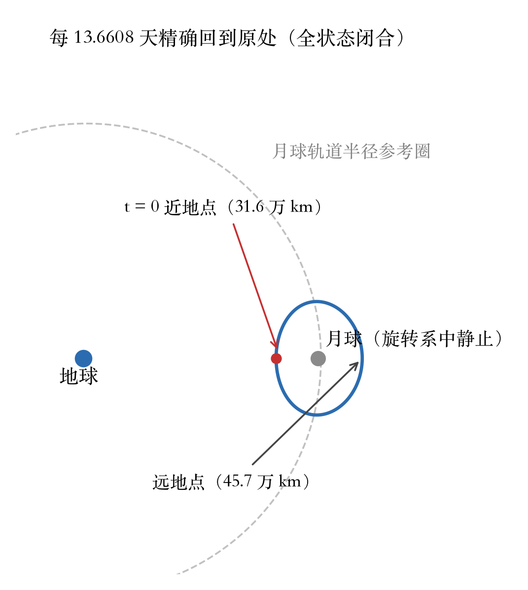
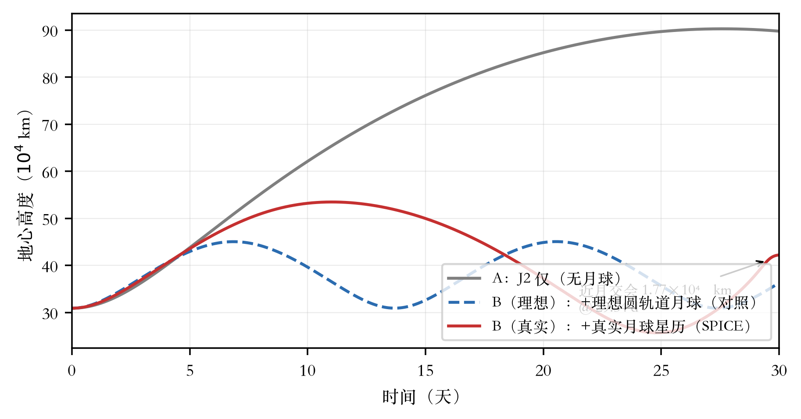

# 第二篇　严格周期解与摄动有界性（LS 专题）

> 本篇数据与判据详见 LS-004／LS-005 报告 [3][4]；立项与评审见 [1][2][5]。

## 2.1 问题与目标

LS 专题把“原型解”推进为**判据严格**的周期解：半周期垂直截面残差、全周期全状态闭合、Jacobi 漂移三项同时约束；初值须由系统化网格扫描给出（无人工特调）；并把严格解搬入“J2–J4 + 真实月球星历 + 简化大气”的高保真模型演化 30 天，回答有界性与维持代价。

## 2.2 严格周期解

对称判据以设计变量 (x₀, v_y₀) 求解 T/2 处的垂直穿越残差 [y, ẋ]→0，收敛后以全周期积分复核。两族解的主要数值见表 2-1。

**表 2-1　严格周期解（无量纲；CRTBP 地月系）**

| 项目 | 2:1（应达） | 3:2（争取） |
|---|---|---|
| 无量纲状态 [x, y, z, ẋ, ẏ, ż] | [0.8087346541, 0, 0, 0, 0.5158236131, 0] | [0.7501227262, 0, 0, 0, 0.6001535514, 0] |
| 周期 | 13.6608 天 | 18.2144 天 |
| 半周期截面残差 | 8.5×10⁻¹¹ | 5.25×10⁻⁹ |
| 全状态闭合残差 | 1.02×10⁻⁹ | 9.48×10⁻⁹ |
| Jacobi 相对漂移 | ≈0 | 3.5×10⁻¹⁶ |
| 迭代次数 | 34 | 29 |

网格扫描（5×5，无人工特调）粗扫 22/25 收敛，精修全部达标；验收脚本实跑扫描收敛 6 个初值。求解器、扫描与验收脚本均沉淀为 MCPC 资产（第四篇 §4.2）。

严格解的轨道形状见图 2-2：在以月球为参照的旋转坐标系里（月球因此“静止”在图中），航天器沿一条大环运行——近地点 31.6 万 km、远地点 45.7 万 km，每 13.6608 天精确回到原处。

*图 2-2　LS 严格解的轨道形状（地月旋转系，月球静止）*

## 2.3 缺陷归零与映射修正（摘要）

- **力历元冻结缺陷**：场景首版未把积分时间同步入力评估，导致月球第三体按 t=0 冻结求值。经自查发现后按机制归零：新增回归测试（先红）→ 修复 → 复测绿 → **缺陷版 30 天实验数据全部作废留档、修复后重跑**（CR-LS-02）；
- **映射修正**：CRTBP→ECI 转换补入质心→地心偏移（μ·L≈4,668 km）及对应速度项，修正后端到端验证通过（CR-LS-03）。

两处修正均不涉及判据；红/修/绿时间戳经质量组审计 [6]。

## 2.4 30 天高保真演化

三组对照：A（J2 仅）／B（+月球）／C（B+简化大气），DOP853（rtol=3×10⁻¹⁰）；月球星历分“理想圆轨道（对照）”与“SPICE 真实星历”两套模型层级。高度演化见图 2-1，主要数值见表 2-2。

*图 2-1　LS 严格解的三组 30 天演化（虚线为理想月球对照）*

**表 2-2　30 天演化结果（修复后）**

| 组 | 有界 | 高度 min / max / final（km） | 关键行为 |
|---|---|---|---|
| A：J2 仅 | 有界 | 309,168 / 902,825 / 897,791 | 准开普勒轨道，远地点 27.6 天 |
| B（理想）：+理想月球 | 有界 | 309,168 / 450,724 / 362,870 | **复现严格解节律**（远地点 6.85/20.54 天；与 CRTBP 参考差 0.1%） |
| B（真实）：+真实月球 | 有界 | 256,939 / 534,894 / 422,363 | 去相位；近月交会 1.77×10⁴ km @ 29.54 天 |
| C：+大气 | 有界 | 与 B 逐位相同 | 阻力在 ≥2.5×10⁵ km 高度不可测（C≡B） |

**结论**：① 有界性成立；② 理想模型下严格解精确复现，验证“求解→映射→场景”链路；③ 真实星历下“有界但不保形”——共振相位不保持是明确结论（非失败）；④ 对该几何，大气问题不触发（近地点远离大气）。

## 2.5 维持 Δv 估算方法与结论

一阶方法：以两体视半长轴漂移 δa 为目标量，单次近地点切向修正的代价 Δv≈(n/2)·|δa|（n 为初始视平均角速度，对应 13.66 天谐振）。实测：理想模型逐周期漂移 ≤170 km（数值零漂移），维持 Δv≈0；真实星历下至第二个近地点（24.81 天）近地点 −5.2×10⁴ km，等效一次修正≈125 m/s（≈5 m/s/天）。多脉冲优化超出该专题边界。

## 2.6 独立验证与回归

- 闭合残差与积分步长无关（5,000↔80,000 步均为 1.02×10⁻⁹）——残差由求解器容差决定；
- RK4／DOP853／Radau 三积分器互差 ≤2.7×10⁻¹²；
- J2–J4 与势函数有限差分一致；跨积分器、步长敏感性证据齐全；
- 回归：LS 套件 51/51（502 s）；含既有回归的全量 297/297（见第四篇 §4.3）。
