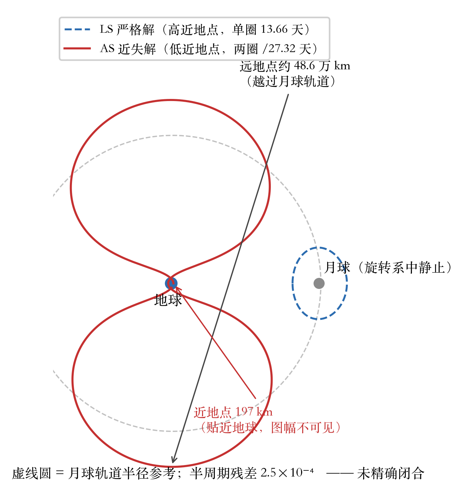
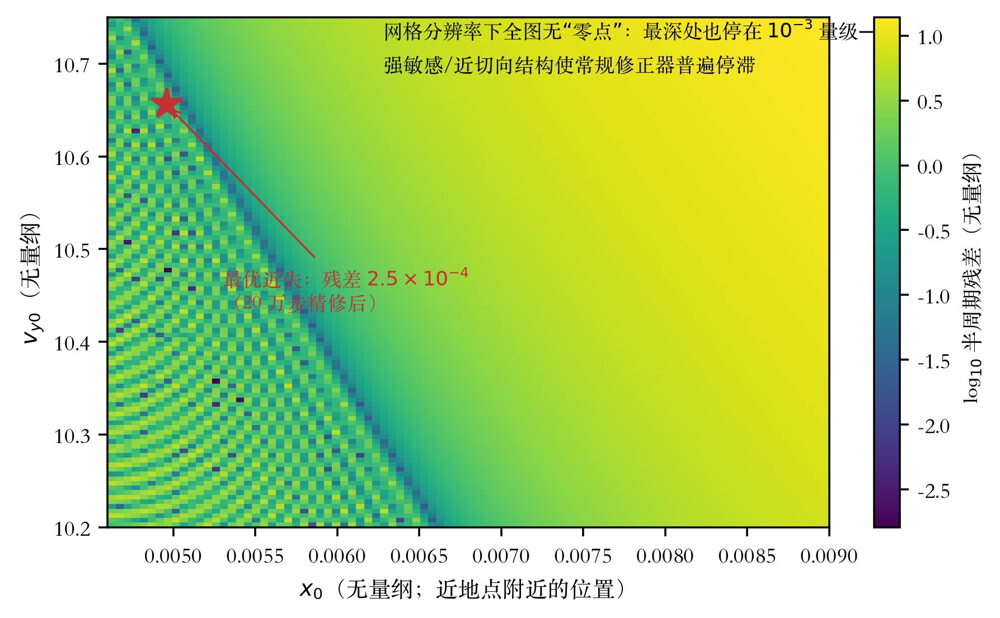
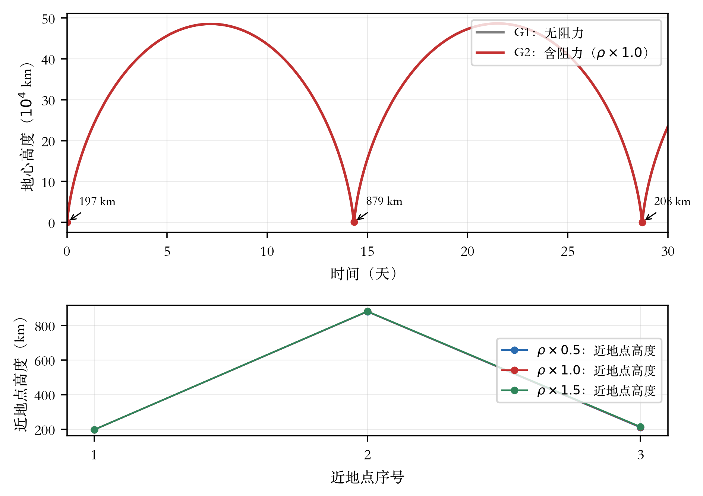
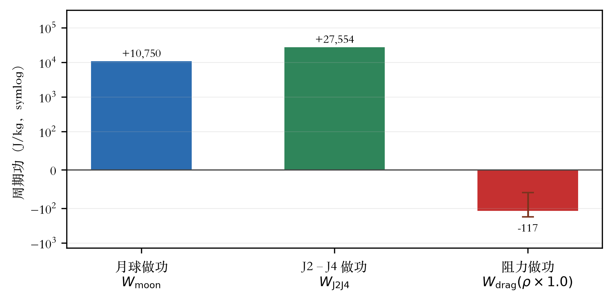

# 第三篇　低近地点族域与能量账本（AS 专题）

> 本篇数据与判据详见 AS-004／AS-005 报告 [8][9]；立项、变更与评审见 [7][10][11]。

## 3.1 问题与目标

AS 专题面向概念所要求的低近地点几何（近地点 ≤200–300 km、远地点近月球、航天器每绕地球 2 圈对应月球 1 圈），设置三个问题：**AS-Q1** 严格周期解是否存在及求解策略；**AS-Q2** 单圈大气损耗与月球做功的能量收支是否闭合；**AS-Q3** 能力沉淀（七项，含 CR-AS-01 加速内核 [10]）。问题设计明确“负结果同样按留档规范交付、不设必须找到”[7]。

## 3.2 求解策略与共振约定

按概念口径确立约定：**p 个航天器惯性周期 : q 个月球周期**（2:1 即航天器惯性周期 13.6608 天；对称截面时刻即一个 T_sc，旋转系闭合周期 27.32 天）。求解工具箱包括：连续法/同伦驱动、线搜索牛顿对称打靶（基于与参考实现逐位一致的 numba fp64 编译内核）、自适应步长 RK4（近地点自动细分）、以及经健全性验证的多重打靶（parallel shooting）实现——在已知的 LS 严格解上三重打靶 3 代收敛至 1.2×10⁻¹³，证明实现无误。

## 3.3 族域勘测：负/部分结果

勘测方法链与覆盖见表 3-1；全部日志可在证据归档 [14] 中重放。

**表 3-1　低近地点 2:1 族域勘测方法链**

| 方法 | 覆盖/规模 | 结果 |
|---|---|---|
| (x₀, v_y₀) 宽盒扫描＋延展过滤 | 90×110（近地点高度约 60–1,750 km） | 过滤后最优半周期残差 8.6×10⁻¹ |
| (近地点高度, 周期因子) 细扫 | 高度 120–300 km × 周期因子 0.94–1.06 | 谷域位于周期因子≈0.9868；最优残差 2.5×10⁻⁴ |
| 局部微扫描（20 万步） | 高度 130–200 km | 沿 ẋ=0 曲线 y*≈1.744×10⁻⁴ 恒定（零曲线平行结构） |
| 自适应积分重验 | 步长细化 5 倍 | 残差不变——排除离散误差地板 |
| 4 维全状态打靶 | ν₀×周期因子×高度约 3,600 种子 | 最优 4 维残差 2.2×10⁻²，批量求根 0 收敛 |
| 多重打靶（k=8/24） | 13 个种子 | 全部未收敛（残差爬行至发散） |
| 宽域裁决图＋交叉精修 | 双变号单元 2,208/1,274 个 | 交点均为亚网格/近切向；60 起点精修无一破 10⁻⁴ |

**结论（限定表述）**：在已勘测域内**未找到低近地点 2:1 严格对称周期解**；数值证据一致指向该区为强敏感/近切向结构（零曲线近乎平行、修正器普适停滞于 10⁻⁴–10⁻³、多重打靶不收敛）。最优近失解——状态 [0.0049602039, 0, 0, 0, 10.6562923, 0]、近地点 197 km、半周期残差 2.5×10⁻⁴——保留为能量实验的初始条件（明确声明：**非严格周期解**）。多重打靶种子质量与同伦加细列为后续技术方向。

近失解与严格解的轨道形状对比见图 3-3；“为什么找不到”的直觉解释见图 3-4——搜索区的半周期残差地图上没有任何“零点”，最深处也只是约 10⁻³ 的噪声地板。

*图 3-3　AS 近失解与 LS 严格解的轨道形状对比（地月旋转系）*

*图 3-4　低近地点搜索区的半周期残差地图（网格分辨率下无零点的强敏感区）*

## 3.4 30 天实验与能量账本

四组同初态对照（J2–J4＋SPICE 真实月球，A/m=0.02 m²/kg，简化指数大气）：G1 无阻力；G2/G3/G4 依次为密度×1.0／×0.5／×1.5。高度演化与近地点序列见图 3-1，能量账本见表 3-2 与图 3-2。

*图 3-1　近失解 30 天高度演化（上）与逐次近地点高度的密度敏感度（下）*

**表 3-2　能量账本（第一周期≈13.66 天；单位 J/kg）**

| 组 | ΔE | 月球做功 | J2–J4 做功 | 阻力做功 | 残差（相对） |
|---|---|---|---|---|---|
| G1 无阻力 | +38,315 | +10,750 | +27,554 | — | 2.8×10⁻⁴ |
| G2 ×1.0 | +38,198 | +10,750 | +27,554 | −116.85 | 2.8×10⁻⁴ |
| G3 ×0.5 | +38,257 | +10,750 | +27,554 | −58.43 | 2.8×10⁻⁴ |
| G4 ×1.5 | +38,140 | +10,750 | +27,554 | −175.28 | 2.8×10⁻⁴ |

*图 3-2　单周期能量收支（symlog；误差棒为密度 ±50%）*

**结论（AS-Q2）**：① 四组 30 天全部保持有界；② 能量收支**未平衡**——月球与 J2 的“供给”分别约为阻力损耗的 92 倍与 236 倍，轨道逐周期抬升（近地点 197→879→208 km），**“能量充裕、相位未闭环”**；③ 阻力损耗 ±50% 密度区间为 [−175.3, −58.4] J/kg（≈0.005–0.016 m/s/周期），不影响量级结论；④ 副产物发现：该几何下 **J2 的周期功大于月球**——真实摄动下维持共振的首要对手是 J2 进动而非大气阻力。

## 3.5 求解加速与独立验证

- **加速内核（CR-AS-01）**：numba fp64 编译内核与参考实现逐位一致（抽样差 ≤4.4×10⁻¹⁶），单轨迹加速 6.1–24.8×；MLX/Metal fp32 筛选层 440 M 状态/秒（批量 ≥65,536 时饱和于 328–384 M 行·步/秒），仅作筛选、缺省自动降级——fp64 精确性由 CPU 路径保证；
- **独立验证**：内核逐位、步长/多积分器一致（自适应 vs DOP853 差 6.4×10⁻⁸）、事件检测、负结果重放四类全过；验收脚本五项全项 PASSED；
- 附：e≈0.98 轨道下 DOP853 在 rtol=10⁻¹¹ 时自身误差约 1.6×10⁻⁶，高保真复核须 ≤10⁻¹³（已入遗留清单）。
